# Auditoria visual do mundo · 28/10 (card NEW-20261028-ORQ-auditoria-arte-mundo)

Base: origin/main `6c9c8f87` (worktree detached `D:/Gits/viagem-wt/auditoria-arte-mundo`), `vite build` + `scripts/gravar-partida.mjs`
(partida solo de verdade, celular 390×844 DPR 3 e PC 1335×620) e cenas do modo foto (`?foto=`, celular 390×844 DPR 2 e
PC 1280×720, swiftshader). Sem código. Prints inteiros em `evidence/auditoria-arte-mundo-28-10/{partida,partida2,cenas}`;
recortes circulados em `evidence/auditoria-arte-mundo-28-10/itens/`.

Fora (pelo card): HUD/menus (E8), jogabilidade (E2), tralha do Uno (E7), escala das torres (espera o usuário).

## Resumo

| # | Item | P | Tam. | Codex? |
|---|------|---|------|--------|
| 1 | Herói com ~0,7 m ao lado do Uno (teto 1,45 m) | P1 | M | não |
| 2 | Inimigo humano ~30 % maior que o herói | P1 | M | não (decisão) |
| 3 | Sombra do Uno é um retângulo duro, maior que o carro | P1 | P | não |
| 4 | Emendas brancas tracejadas no paralelepípedo (grade iso aparece) | P1 | P–M | não |
| 5 | Paralelepípedo borrado perto dos sprites nítidos | P2 | M | sim |
| 6 | Herói local com contorno triplo (escuro + creme + escuro): parece adesivo | P2 | P | não |
| 7 | Herói/caixa em cartum chapado × inimigos e cenário pintados | P2 | G | sim (decisão) |
| 8 | Aura do Defumador lê como terra/palha no chão, não como fumaça | P2 | P–M | sim |
| 9 | Sombra dos inimigos é um "fantasma" lilás solto do pé | P2 | P | não |
| 10 | Fala do Uno sem balão, por cima do carro e cortada | P2 | P | não |
| 11 | Beira da neve: faixa lilás chapada e saturada, sem volume | P3 | M | talvez |
| 12 | Rótulos no mundo se sobrepõem e o menor tem ~9 px | P2 | P | não |
| 13 | Armas na mão e no chão maiores que o herói | P2 | P | não |
| 14 | Barra de vida do ninho some no meio da arte | P3 | P | não |
| 15 | Fios do poste passam por cima do herói e da barra dele | P3 | P | não |
| 16 | "Te derrubou: X" creme sobre fundo claro: ilegível na neve | P1 | P | não |
| 17 | Sombra dos prédios: polígono lilás chapado de borda dura | P3 | M | não |
| 18 | Lobo (furry) com azul elétrico saturado fora da paleta | P3 | P–M | talvez |

Tamanho: P ≤ 1 h, M ≤ meio dia, G > meio dia.

## Itens

### 1 · Herói com ~0,7 m ao lado do Uno · P1 · M
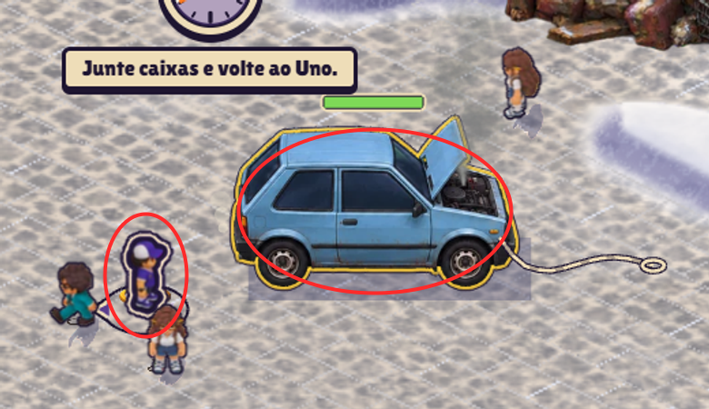

No PC (uno-pc/fim.png), o Uno mede ~112 px da roda ao teto (`CAR_TOP` = 1,45 m), ou seja ~77 px/m. O herói mede ~55 px:
~0,7 m. Deveria chegar mais ou menos à altura do teto (~1,1–1,3 m, mesmo em proporção compacta). O mesmo vale para os
aliados (Coach, Concurseira). No celular, o herói parado fica abaixo da linha das janelas.

**Proposta:** escolher uma régua só (herói ≈ 0,9 × altura do teto do Uno) e ajustar *um* dos lados: subir
`HERO_DRAW_SCALE` (0,8) ou baixar `UNO_SCALE`. Como o Uno está casado com a pegada física (`CAR_HALF`, colisão e corda),
o lado barato é o herói, mas isso mexe na leitura da horda inteira, então combinar com o card `estudo-escala-mapa`
antes. Medir com a cena `cidade-regua` (régua em alturas de herói) depois do ajuste.

**Escopo:** `src/client/render/draw-scale.ts` (HERO_DRAW_SCALE), `src/client/render/chaveiro/uno-art.ts` (UNO_SCALE),
`src/client/render/chaveiro/figures.ts` (CAR_HALF, CAR_TOP), `src/client/framing.ts` (CITY_VIEW_SCALE). Imagem nova: não.

### 2 · Inimigo humano ~30 % maior que o herói · P1 · M
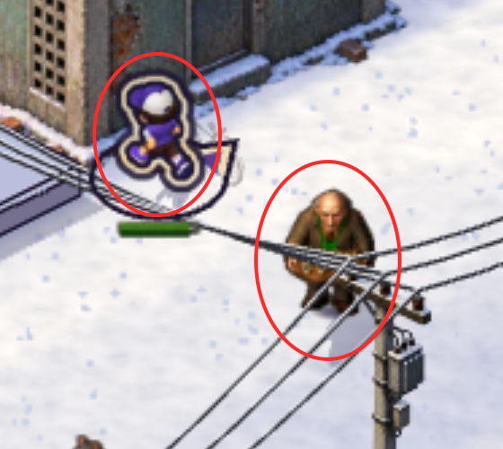

No celular (andando-celular/fim.png), o velho de casaco mede ~125 px e o herói ~95 px (sem o contorno). Ninhos (cena
`ninhos`) e `luta` mostram o mesmo: o "Tio" de regata é mais alto que qualquer herói. Inimigo comum maior que o
jogador desfaz a hierarquia "ameaça, personagem local, aliados" da `docs/art-direction.md` pelo lado errado: o herói
some na horda.

**Proposta:** definir a altura-alvo por categoria (herói = 1,0; humano comum = 0,9–1,0; elite = 1,2; chefão à parte) e
aplicar por fator de escala do inimigo, sem regerar arte. Decisão do usuário junto com o item 1.

**Escopo:** `src/client/art/horde-art.ts` (escala por inimigo, ELITE_ART_SCALE), `src/client/art/enemy-feet.ts`,
`src/client/render/draw-scale.ts`. Imagem nova: não.

### 3 · Sombra do Uno é um retângulo duro · P1 · P
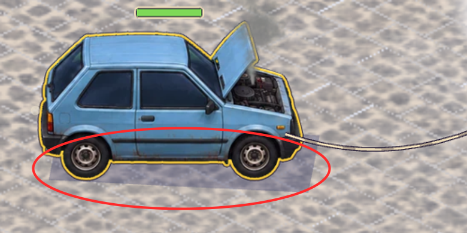

Embaixo do carro aparece um paralelogramo lilás de bordas retas, mais comprido que a carroceria e saindo para a
direita (cena `carro-andando`, e igual na partida: uno-pc/fim.png). Com a arte do Uno já pintada, essa caixa é a
"sombra provisória" da época dos blocos.

**Proposta:** trocar por sombra de contato elíptica e macia (como `CONTACT` dos inimigos) do tamanho da pegada, mais
um leve deslocamento para a direita-baixo; ou a silhueta da própria vista achatada (`SILHOUETTE`), como os inimigos.

**Escopo:** `src/client/render/chaveiro/renderer.ts` (`drawShadow`, ~L451, e as chamadas em ~L242 e ~L308 da moto),
`src/client/render/shadow-rules.ts` (reaproveitar CONTACT/SILHOUETTE). Imagem nova: não.

### 4 · Emendas brancas tracejadas no paralelepípedo · P1 · P–M
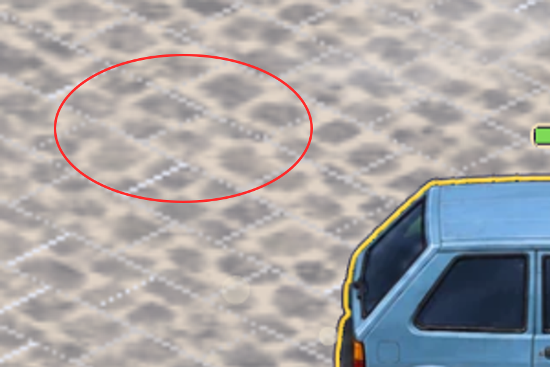

No paralelepípedo aparece uma grade isométrica de tracinhos brancos (célula a célula), em todo lugar onde há
paralelepípedo: partida no celular e no PC, cenas `carro-andando` e `kit-obra`. Parece fresta entre os quads da
textura projetada (o branco da neve/fundo vazando) ou a junta procedural ainda desenhada por cima da arte.

**Proposta:** conferir primeiro se é junta (`decorOver` deveria ser false com textura) ou fresta de rasterização;
fresta se resolve com sobreposição de meio pixel nos quads ou desenhando o chão do bloco num único mesh/RenderTexture.

**Escopo:** `src/client/render/city/city-layer.ts`, `src/client/render/city/chunks.ts`, `src/client/render/city/tris.ts`,
`src/client/render/city/materials.ts`, `src/client/render/city/palette.ts` (`calcada-junta`). Imagem nova: não.

### 5 · Paralelepípedo borrado perto dos sprites nítidos · P2 · M
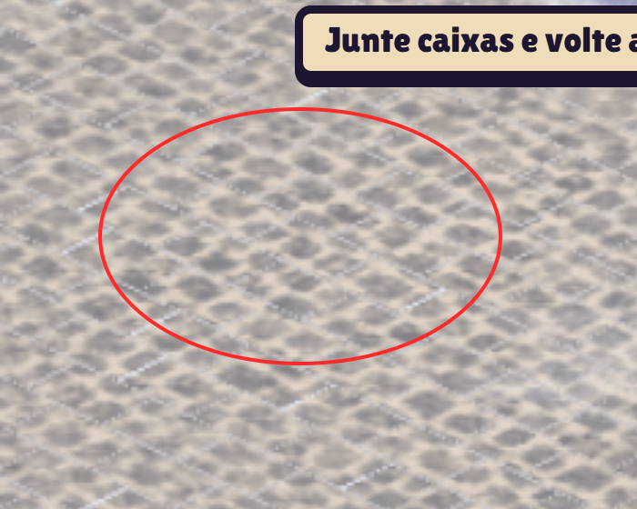

A textura de chão (512×512 para 4,4 u) fica macia e lavada no celular (DPR 3): as pedras viram manchas cinzentas,
enquanto prédios, Uno e caixas têm detalhe fino. O chão é o que mais aparece na tela no começo da partida (spawn é
quase só paralelepípedo).

**Proposta:** regerar `paralelepipedo-*` e `calcada-*` em 1024 px com pedras maiores e contraste um pouco maior
(o chão não pode competir com personagens, mas precisa ler como pedra). Medir o peso no celular antes (textura GPU).

**Escopo:** `public/art/ground/cidade-nevada/paralelepipedo-{1,2}.webp`, `calcada-{1,2,3}.webp`,
`src/client/render/city/materials.ts` (GROUND_TILE_UNITS / tamanho), `src/client/preload/match-assets.ts`.
Imagem nova: **sim (Codex)**.

### 6 · Herói local com contorno triplo · P2 · P
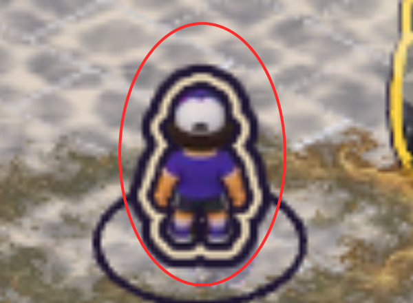

O herói do jogador tem contorno escuro + faixa creme + escuro, grosso, mais o anel no chão com a seta. Aliados e
inimigos não têm contorno nenhum. O herói fica com cara de adesivo colado no cenário e a faixa creme come a silhueta
(o boné e as mãos somem dentro dela).

**Proposta:** manter o anel no chão + seta (já identificam "você") e reduzir o contorno a 1 traço escuro fino, ou
trocar a faixa creme por um brilho de borda de 1 px na cor do herói.

**Escopo:** `src/client/render/you.ts`, `src/client/render/you-rules.ts`, `src/client/render/outline.ts`. Imagem nova: não.

### 7 · Herói e caixa em cartum chapado × inimigos e cenário pintados · P2 · G
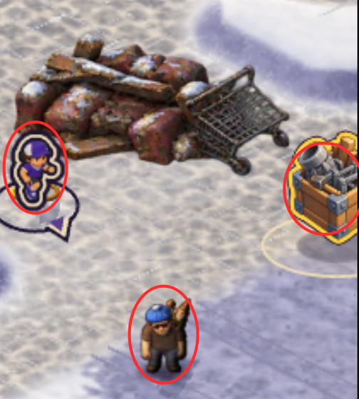

No mesmo quadro: herói chibi de cores chapadas e contorno grosso, caixa de saque em cartum com borda amarela, e
inimigo/entulho/prédio em pintura realista com textura. As duas linguagens não se misturam; o herói parece de outro
jogo. (A direção pede heróis compactos e expressivos, então o chibi em si não é o problema: é a pintura.)

**Proposta:** decisão do usuário. Caminho barato: um passe de sombreado pintado (luz de cima-esquerda, sombra
própria) nas folhas dos heróis via Codex usando um inimigo como referência de material; caminho caro: regerar heróis.
A caixa de saque pode ganhar a mesma madeira pintada das barricadas.

**Escopo:** `public/art/...` folhas dos heróis (scripts/art-v2, `scripts/import-art-v2.mjs`),
`src/client/sprites/character-sprites.ts`, `public/art/city/base/caixa-saque.webp` (manifest `caixa-saque`).
Imagem nova: **sim (Codex)**, seguir a skill `personagem-animado`.

### 8 · Aura do Defumador lê como terra no chão · P2 · P–M
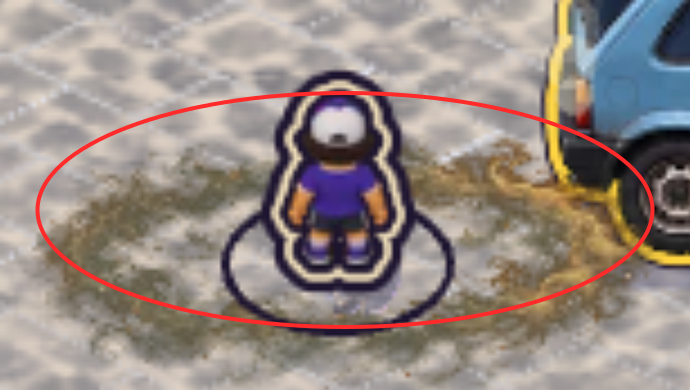

Depois da 1ª carta (uno-celular, a partir de ~19 s), aparece um anel marrom-palha em volta do herói. Parado ele parece
terra/feno pisado, não fumaça; não tem movimento perceptível nos quadros (ciclo de 5,2 s com 2 quadros) nem volume.

**Proposta:** fumaça clara acinzentada com volume (puffs subindo, parte por cima do pé do herói), 4–6 quadros em
vez de 2, e alfa mais baixo no chão. Se ficar só no shader/alfa, conferir primeiro com `AURA_SELF_ALPHA`.

**Escopo:** `src/client/render/aura-ring.ts` (AURA_FRAMES, AURA_CYCLE_MS, alfas), `public/art/fx/aura-defumador.webp`.
Imagem nova: **sim (Codex)**, folha de fumaça.

### 9 · Sombra dos inimigos é um "fantasma" lilás · P2 · P
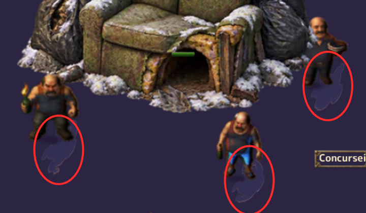

A sombra projetada dos inimigos é a silhueta inteira achatada e girada para baixo-direita: com cabeça e braços ela
vira uma forma de fantasma com "rabo", e quase não encosta no pé (cena `ninhos`; na partida, os humanos do bairro).
Sobre neve escura/lilás ela some; sobre neve clara ela chama mais atenção que o pé.

**Proposta:** encurtar e borrar a silhueta (flatten menor, desfoque/alfa decrescente para a ponta), garantir a
sombra de contato oval sob o pé sempre presente, e baixar o alfa da silhueta.

**Escopo:** `src/client/render/shadow-rules.ts` (SILHOUETTE, CONTACT, castOffset), `src/client/render/silhouette.ts`.
Imagem nova: não.

### 10 · Fala do Uno sem balão e cortada · P2 · P
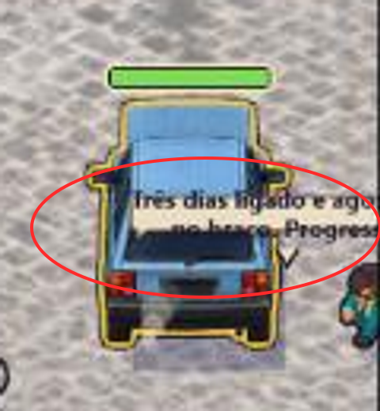

Aos ~6 s (uno-celular, quadro 2 do GIF), o texto "Três dias ligado e agora… Progress…" aparece por cima do carro,
sem fundo legível, e passa da borda da tela. Print em 270 px (do GIF): **confirmar em resolução cheia** antes de
abrir o card; se o balão existe e só está com contraste baixo, o item vira só "prender o balão dentro da tela".

**Proposta:** balão com fundo papel e contorno breu como as falas do chaveiro, preso dentro da tela (clamp nas
bordas) e acima do teto do carro, não sobre a lataria.

**Escopo:** `src/client/render/chaveiro/talk.ts`, `src/client/render/chaveiro/renderer.ts`. Imagem nova: não.

### 11 · Beira da neve com faixa lilás chapada · P3 · M
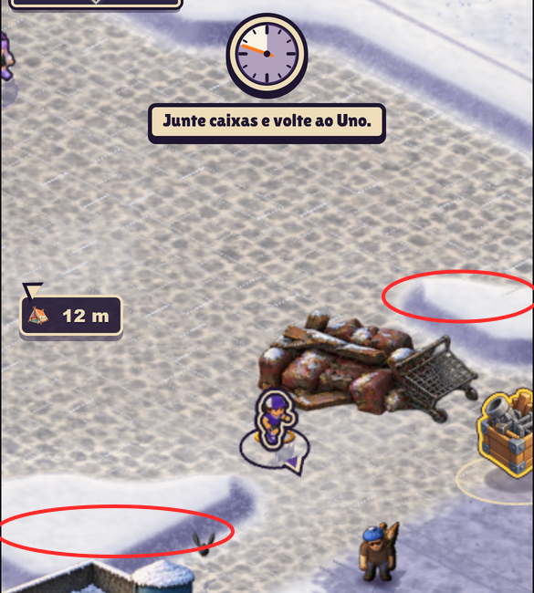

Todo monte de neve e toda borda de calçada tem uma faixa lilás saturada e de largura constante. De longe parece um
contorno desenhado em volta da neve, não a sombra de um monte (não afina, não degradê). Com o chão cinza e a neve
branca, o lilás é a cor mais forte da tela fora a HUD.

**Proposta:** degradê da sombra (mais escura no pé do monte, sumindo para cima), lilás menos saturado (puxar para o
cinza-azulado da sombra da neve dos prédios) e largura variável pelo relevo.

**Escopo:** `src/client/render/city-edge-rules.ts`, `src/client/render/city/palette.ts`, `src/client/render/city/relevo/`,
`src/client/render/city/tri-band.ts`. Imagem nova: talvez (se virar textura de borda).

### 12 · Rótulos no mundo se sobrepõem e o menor tem ~9 px · P2 · P
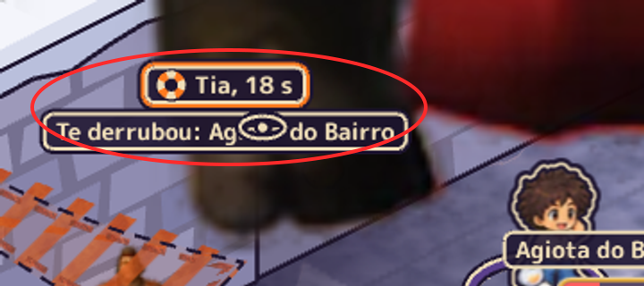
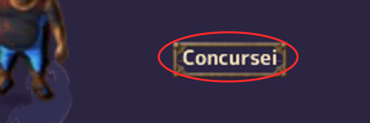

Cena `nome-elite-chefao` (PC): "Tia, 18 s" encosta em "Te derrubou: Ag… do Bairro" e o ícone de olho fica **por cima**
do nome ("Ag👁do Bairro"). O rótulo "Concursei" (cenas `ninhos` e `arsenal`) tem ~9 px de altura de letra no PC e é
cortado ("Concursei[ra]").

**Proposta:** empilhar rótulos do mesmo ator com espaçamento fixo (o ícone na própria linha, à esquerda), corpo mínimo
de 12 px CSS no celular, e não truncar nome curto.

**Escopo:** `src/client/render/map-labels.ts`, `src/client/render/map-label-rules.ts`,
`src/client/render/enemy-name-rules.ts`, `src/client/render/downed.ts`, `src/client/render/downed-rules.ts`. Imagem nova: não.

### 13 · Armas maiores que o herói · P2 · P
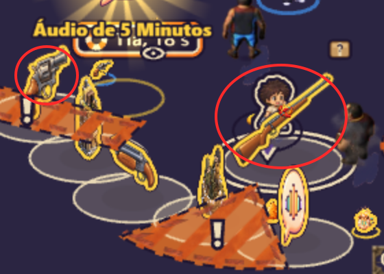

Cena `arsenal` (celular): a espingarda na mão da heroína é maior que ela inteira, e o revólver caído no chão é maior
que a cabeça dela. Itens no chão com o mesmo contorno amarelo grosso parecem ícones de HUD soltos no mapa.

**Proposta:** arma na mão ≈ 0,6–0,7 da altura do herói (escopeta/fuzil) e ≈ 0,3 (pistola); itens no chão com metade do
tamanho atual e contorno amarelo fino (o brilho de "pode pegar" já chama atenção).

**Escopo:** `src/client/render/arsenal-rules.ts` (escalas de desenho), `src/client/render/arsenal-a2-look.ts`,
`src/client/render/arsenal-fx.ts`, `src/client/render/usable-glow-rules.ts`. Imagem nova: não.

### 14 · Barra de vida do ninho some no meio da arte · P3 · P
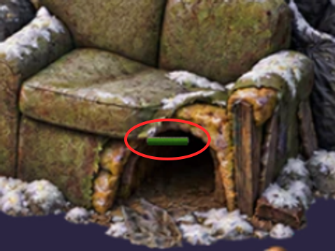

No ninho (sofá com sacos), a barra de vida é um traço verde de ~30 px dentro da boca do sofá, sem fundo nem
contorno. Não lê como barra e fica no meio do desenho.

**Proposta:** barra acima do topo da arte, com fundo escuro e contorno breu, como a do Uno.

**Escopo:** `src/client/render/city/live/layer.ts` (ninhos), `src/client/render/city/live/rules.ts`. Imagem nova: não.

### 15 · Fios do poste por cima do herói · P3 · P
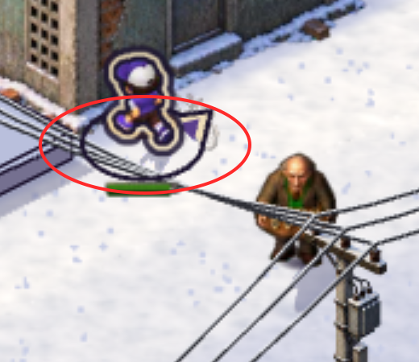

No bairro dos postes (andando-celular/fim.png), três fios atravessam o herói, o anel dele e a barra de vida verde.
A ordem pode estar certa no espaço (o fio está alto e à frente), mas a leitura do personagem local piora.

**Proposta:** fios a ~50 % de alfa quando passam dentro do raio do herói local (como as casas que esmaecem), ou
desenhá-los abaixo da camada dos marcadores do herói (anel, seta, barra).

**Escopo:** `src/client/render/city/live/layer.ts` (`drawWire`, profundidade em ~L242), `src/client/render/city/occlusion.ts`.
Imagem nova: não.

### 16 · "Te derrubou: X" ilegível na neve · P1 · P
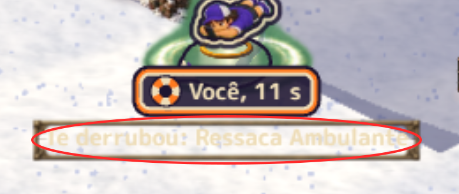

Partida real, herói caído no meio da horda (partida2/empurra-celular/fim.png): a linha "Te derrubou: Ressaca Ambulante"
sob a ficha "Você, 11 s" tem letra creme sobre fundo creme translúcido, em cima de neve branca. Não dá para ler,
justamente no momento em que o jogador olha para o próprio herói.

**Proposta:** mesmo estilo da ficha de cima (fundo breu opaco, letra papel) ou fundo papel opaco com letra breu;
nunca fundo translúcido sobre neve.

**Escopo:** `src/client/scene.ts` (~L392, ficha do caído), `src/client/render/enemy-name-rules.ts` (fallenByText),
`src/client/render/downed.ts`. Imagem nova: não.

### 17 · Sombra dos prédios chapada de borda dura · P3 · M
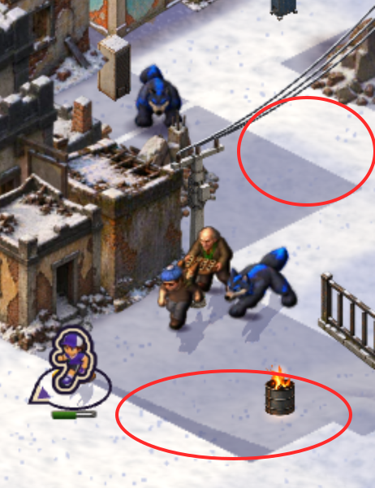

Com a luz ligada, cada prédio projeta um polígono lilás uniforme e de borda reta que atravessa a rua, os postes e os
inimigos (partida2/empurra-celular/meio.png). Não tem degradê nem borda macia, e o lilás é o mesmo das bordas da neve
(item 11): a rua inteira vira faixas geométricas.

**Proposta:** borda macia (penumbra de alguns px, pode ser feita no bake do chunk, que já é RenderTexture), alfa caindo
com a distância do prédio e cor um pouco mais fria/cinza que o lilás atual.

**Escopo:** `src/client/render/city/city-layer.ts` (CAST_SHADOW, bake do chunk), `src/client/render/city/decor.ts`
(`shadowUnion`), `src/client/render/light.ts` (LIT_SHADOW, SHADOW_PER_HEIGHT). Imagem nova: não.

### 18 · Lobo (furry) azul elétrico fora da paleta · P3 · P–M
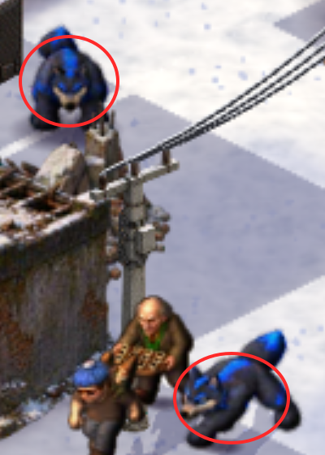

Os lobos da horda têm manchas azul-elétrico saturado com brilho, enquanto o resto do mundo (inimigos, prédios, neve)
é dessaturado e quente. Na horda eles são a primeira coisa que o olho vê, mais que o herói. Se a ideia é "fantasia
de convenção" (furry), o azul pode ficar, mas um tom abaixo.

**Proposta:** baixar saturação/brilho do azul (~30 %) por tint ou regerar a folha; confirmar com o usuário se o azul
forte é intencional.

**Escopo:** folha do `furry-de-convencao` em `public/art/...` (manifest), `src/client/art/horde-art.ts` (tint por
inimigo, se for por código). Imagem nova: talvez (Codex, se o tint não bastar).

## Observações (não são itens de arte)

- `andando pc` da 1ª gravação não entrou na partida em 180 s ("Não foi possível começar a partida", partida/andando-pc/falha.png);
  as outras três entraram em 6–8 s. Provável Worker local/GPU, não arte.
- As cenas do modo foto `sombra` e `luta` não ficaram prontas em 90 s (`__fotoPronta` nunca virou true) e `ninhos` no
  celular também não; as cenas da cidade no modo foto aparecem sem o terreno (fundo roxo) em vários casos. Vale um card
  para o modo foto (fora desta auditoria).
